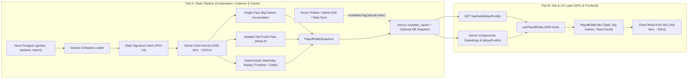

# TDD: BASH Playoff Odds Predictor — Stats Pipeline & Site/UX Architecture

> **Status**: Ready for Implementation  
> **Author**: BASH Development Team  
> **Created**: 2026-11-22  
> **Branch**: `sports_club_stats_rebuild`  
> **Related Docs**:
> - [Product Requirements Document](./prd-playoff-odds.md)
> - [Deep Research Report](./research-sports-club-stats.md)

---

## Architecture Overview: Decoupled Two-Layer Design

Per product requirements, this technical design is strictly separated into two independent architectural domains connected by a single immutable data contract (`PlayoffOddsSnapshot`):



---

# Part A: Stats Pipeline Architecture

## A.1 Update Cadence Analysis: Weekly vs. Daily vs. After Games Are Scored

A central architectural question is **when and how the Monte Carlo simulation pipeline should run**: once per week, on a daily cron, or immediately after games are scored?

### Empirical Performance Reality Check

Unlike Ken Roberts's 2008 NHL simulator (30 teams, 1,230 games, multi-minute C# runs), BASH has **6–7 teams and 24–63 regular-season games**. Our Node/TypeScript typed-array kernel benchmarked on real 2018–2019 BASH data (7 teams, 24 remaining games) ran:

| Workload | Iterations | Measured Latency (Single Thread) |
|---|---:|---:|
| Main Simulation + Single-Pass Big Games | 100,000 | **~85–135 ms** |
| Isolated Tail-Probing Pass (Win-Out / Lose-Out per team) | 1,000 × 2 × 7 teams | **~15–20 ms** |
| Historical Matchday Replay (e.g., 5–15 matchdays @ 10,000 iters/day) | 50,000–150,000 | **~45–120 ms** |
| **Total Full Cold Snapshot Generation** | **~200k–260k total** | **~160–275 ms** |
| Client-Side Interactive What-If Override | 20,000 | **~20–30 ms** |

### Comparison of Pipeline Cadence Options

| Cadence Strategy | Freshness After Saturday Games | Operational Complexity | Failure / Drift Risk | Verdict |
|---|---|---|---|---|
| **1. Weekly Cron Only** (e.g., Sunday night) | **Poor** — Games happen Saturday 9am, 11am, 1pm; players check standings/odds *between* games and Saturday evening. Weekly cron leaves data stale for 24–144 hours if a reschedule or mid-week forfeit occurs. | Medium (new Vercel cron + storage) | High if cron fails or admin edits a score Tuesday | **Rejected** |
| **2. Daily Cron Only** (`/api/bash/sync` at `00:00 UTC`) | **Mediocre** — Still stale for ~6–14 hours on Saturday afternoon right when traffic peaks after BASH games end! | Low (reuse existing cron) | Medium (admin score edits still lag up to 24h) | **Insufficient alone; good as safety net** |
| **3. Event-Driven After Games Are Scored + Daily Cron Safety Net + Content-Addressed Caching (RECOMMENDED)** | **Instant (`< 30s`)** — Immediately reflects every finalized game (`scorekeeper/finalize`), admin score/forfeit edit (`schedule/[gameId]`), and Sportability sync (`/api/bash/sync`). | **Very Low** — Zero new cron jobs, zero Neon transaction risk, deterministic output across serverless instances. | **Minimal** — Deterministic hash key guarantees identical results; if cache ever evicts, cold compute finishes in ~200 ms. | **Selected Architecture** |

### Recommended Pipeline Strategy (Two-Tier Execution)

1. **Tier 1 (Immediate v1 — Active in Production Immediately, Zero Schema Migration Needed)**:
   - **Content-Addressed Deterministic Compute + Tag-Invalidated `unstable_cache`**:
     - `fetchPlayoffOddsSnapshot(seasonId, mode)` queries the season's regular-season games + season metadata in a single `Promise.all` (1 Neon HTTP round-trip wave, matching `AGENTS.md`), computes a canonical **State Signature Hash** from `(seasonId, mode, playoffSpots, sortedGamesState)`, and runs the deterministic Monte Carlo pipeline inside Next.js `unstable_cache` (tagged `["seasons", "playoff-odds", "public-page-data"]`, TTL `30s`–`300s`).
     - Because the PRNG is **seeded from the State Signature Hash**, any two serverless cold starts computing the same game state produce **bit-for-bit identical probabilities**—eliminating Monte Carlo "jitter" on page refresh!
   - **Event-Driven Invalidation Hooks ("After Games Are Scored")**:
     - Call `revalidateTag("playoff-odds")` (alongside `"seasons"`) at every single write boundary where game scores, statuses, or schedules change:
       1. `POST /api/bash/scorekeeper/[id]/finalize` — right after `games` is updated to `status = 'final'` (line ~787, inside/alongside `after()`).
       2. `PATCH` & `DELETE /api/bash/admin/seasons/[id]/schedule/[gameId]` — already calls `revalidateTag("seasons")`.
       3. `POST /api/bash/admin/seasons/[id]/schedule` & `/generate` & `/playoffs` — already call `revalidateTag("seasons")`.
       4. `GET /api/bash/sync` (daily `0 0 * * *` Vercel cron) — add `revalidateTag("playoff-odds")` whenever `scheduleResult.updatesApplied > 0` or `gamesCreated > 0` (acts as daily reconciliation safety net!).
   - **Historical Timeline Optimization**:
     - Completed past matchdays never change! Each historical matchday point `(seasonId, mode, matchdayDate, gamesUpToDateHash)` is deterministic and can be cached independently or computed in ~60 ms total at `10,000` iterations per matchday (standard error `< 0.5%`, visually indistinguishable on a chart).
2. **Tier 2 (Optional Additive Persistence — `playoff_odds_snapshots` Table)**:
   - Documented in Section B.2 below as a clean additive migration (`scripts/deploy-playoff-odds-schema.ts`) once the team wants permanent archived snapshots in Postgres (e.g., for external push alerts *"Your team's playoff odds jumped +18% today!"* or historical auditing across future model versions).
   - Uses single-statement idempotent `INSERT ... ON CONFLICT (season_id, mode, state_hash) DO UPDATE`—strictly respecting BASH's `neon-http` no-`db.transaction()` constraint.
   - Crucial decoupling: the read path gracefully falls back to Tier 1 compute if the table is not yet deployed, so **zero destructive or premature production DB changes are required**.

---

## A.2 Core Simulation Engine (`lib/playoff-odds.ts`)

The entire stats pipeline lives in a pure, zero-DB, zero-React TypeScript module (`lib/playoff-odds.ts`) so it executes identically on:
- **Node.js / Vercel Serverless** (100,000 iterations for official public snapshots)
- **Browser Client** (20,000 iterations for instant Interactive What-If game overrides)
- **Vitest Test Suite** (deterministic reproducible assertions)

### A.2.1 Season Rules & Playoff Format Resolution

```ts
export interface PlayoffFormat {
  teamCount: number
  playoffSpots: number
  directByeSpots: number // e.g., 3 in 7-team 5-spot Fall (Rule 412: Seeds 1-3 bye, 4v5 play-in)
  hasPlayIn: boolean     // true when playoffSpots === 5 && teamCount >= 7 && seasonType === "fall"
  allTeamsQualify: boolean // true in Summer (Rule 219) or playoffSpots >= teamCount
}
```

Resolution order (`resolvePlayoffFormat`):
1. Identify active regular-season teams from non-legacy (`!isLegacyTeamSlug`) games where `gameType === "regular" && !isPlayoff`.
2. Determine `playoffSpots`:
   - If `seasonStatus === "completed"` and actual non-legacy playoff games exist with `>= 2` distinct participants, use `Math.min(actualPlayoffTeamCount, teamCount)` (fixes historical DB seasons that predate the `playoff_teams` column and retained default `4`).
   - Else if `seasonType === "summer"`, default to `teamCount` (Rule 219: all teams qualify) unless an explicit `playoffTeams` `< teamCount` was configured on an active season.
   - Else if `configuredPlayoffTeams` is explicitly set and valid (`1 <= configuredPlayoffTeams <= teamCount`), use it (for active `bash-2026-2027`, DB has `playoff_teams = 5`!).
   - Else apply Rule 412 fallback: `teamCount >= 7 ? 5 : Math.min(4, teamCount)`.
3. Set `hasPlayIn = seasonType === "fall" && playoffSpots === 5 && teamCount >= 7` and `directByeSpots = hasPlayIn ? 3 : 0`.

### A.2.2 Calibration Constants (Empirically Verified on 2,126 BASH Games)

```ts
export const BASH_CALIBRATION = {
  fall: {
    pythagenPuckPower: 0.22,  // Optimal Fall P (R² = 0.8617, Brier = 0.2369)
    ebShrinkageGames: 10,     // Empirical Bayes prior C = 10 games toward 0.500
    otRate: 0.075,            // Calibrated OT win rate (counts toward ROW)
    soRate: 0.045,            // Calibrated Shootout win rate (excluded from ROW)
    homeFieldAdvantage: 0.50, // Empirical 49.32% — single outdoor venue (zero HFA)
  },
  summer: {
    pythagenPuckPower: 0.37,  // Optimal Summer P (R² = 0.8048, Brier = 0.2264)
    ebShrinkageGames: 6,      // Empirical Bayes prior C = 6 games toward 0.500
    otRate: 0.055,            // Calibrated Summer OT rate
    soRate: 0.035,            // Calibrated Summer SO rate
    homeFieldAdvantage: 0.50, // Empirical 49.45% — zero HFA
  },
} as const
```

### A.2.3 Team Strength Calculation (3 Modes)

For each team $i$ from completed regular-season games (note: double forfeits give `0-5` loss & `0 pts` per Rule 208; single forfeits give `5-0` 3-pt win; non-forfeit goals are used for PythagenPuck scoring rates when non-forfeit GP $> 0$ so administrative forfeits don't distort true goal efficiency!):
- **`weighted` (Default — BASH Calibrated)**:
  - Compute $\text{GFg}_i = \text{GF}_{\text{played}} / \text{GP}_{\text{played}}$ and $\text{GAg}_i = \text{GA}_{\text{played}} / \text{GP}_{\text{played}}$ (with fallback `.500` if `0` GP; smooth `+0.5` total floor if `GF=0` or `GA=0` to prevent `0.000`/`1.000` Log5 singularities!).
  - $E_i = \max(0.5, (\text{GFg}_i + \text{GAg}_i)^P)$
  - $S_{\text{raw}, i} = \frac{\text{GFg}_i^{E_i}}{\text{GFg}_i^{E_i} + \text{GAg}_i^{E_i}}$
  - $S_i = \frac{\text{GP}_{\text{played}} \cdot S_{\text{raw}, i} + C \cdot 0.5}{\text{GP}_{\text{played}} + C}$
  - Clamped safely to `[0.05, 0.95]`.
- **`50_50` (Coin Flip)**:
  - $S_i = 0.500$ for all teams.
- **`classic` (Sports Club Stats Exact Replica)**:
  - $S_{\text{raw}, i} = \text{GP}_i > 0 ? \frac{\text{PTS}_i}{3 \cdot \text{GP}_i} : 0.5$
  - Season completion $f_i = \frac{\text{GP}_i}{\text{GP}_i + \text{Rem}_i}$
  - Ken's exact `p225` regression:
    $$r(f) = \begin{cases} (-1.5 f + 1.0) + 0.1 f & f < 0.5 \\ (-0.5 f + 0.5) + 0.1 f & f \ge 0.5 \end{cases}$$
  - $S_i = S_{\text{raw}, i} - (S_{\text{raw}, i} - 0.5) \cdot r(f_i)$, clamped to `[0.05, 0.95]`.

### A.2.4 Matchup Outcome Probabilities (4/6-Outcome Distribution)

For remaining game $g$ with Away team $a$ and Home team $h$:
1. Overall win probability via **Bill James Log5** (`HFA = 0.50`):
   $$p_h = \frac{S_h (1 - S_a)}{S_h (1 - S_a) + S_a (1 - S_h)}, \qquad p_a = 1 - p_h$$
2. Matchup-scaled extra-time probability (evenly matched teams go to OT slightly more often than mismatches, preserving the league-average OT+SO rate):
   $$m_g = 4 p_h (1 - p_h) \in (0, 1]$$
   $$p_{\text{OT}, g} = \text{otRate} \cdot (0.5 + 0.5 \cdot m_g), \qquad p_{\text{SO}, g} = \text{soRate} \cdot (0.5 + 0.5 \cdot m_g)$$
   $$p_{\text{extra}, g} = p_{\text{OT}, g} + p_{\text{SO}, g}$$
3. Six exact mutually exclusive outcomes summing to `1.0`:
   - `HOME_REG` (`+3 pts, +1 ROW` to home; `0` to away): $(1 - p_{\text{extra}, g}) \cdot p_h$
   - `HOME_OT` (`+2 pts, +1 ROW` to home; `+1 pt` to away): $p_{\text{OT}, g} \cdot p_h^{\text{OT}}$, where $p_h^{\text{OT}} = 0.5 + 0.7 (p_h - 0.5)$ (sudden death retains strength edge)
   - `HOME_SO` (`+2 pts, 0 ROW` to home; `+1 pt` to away): $p_{\text{SO}, g} \cdot (0.5 + 0.3 (p_h - 0.5))$ (shootouts are closer to 50/50)
   - `AWAY_SO` (`+1 pt` to home; `+2 pts, 0 ROW` to away): $p_{\text{SO}, g} \cdot (1 - p_h^{\text{SO}})$
   - `AWAY_OT` (`+1 pt` to home; `+2 pts, +1 ROW` to away): $p_{\text{OT}, g} \cdot (1 - p_h^{\text{OT}})$
   - `AWAY_REG` (`0` to home; `+3 pts, +1 ROW` to away): $(1 - p_{\text{extra}, g}) \cdot (1 - p_h)$
4. Precompute cumulative thresholds `[c0, c1, c2, c3, c4, 1.0]` per remaining game before entering the hot loop so each simulated game takes a single PRNG draw!
5. Goal margin per simulated game (for `GD` / `GF` tiebreakers):
   - OT/SO: winning margin = `1` (`GF += 3` winner, `2` loser).
   - Regulation: discrete BASH empirical margin `[1, 2, 3, 4, 5, 6]` with weights `[0.28, 0.27, 0.20, 0.12, 0.08, 0.05]`, adding `margin` to `GD` and `loserGoals + margin` to `GF`.

### A.2.5 Exact Rule 213 Tiebreaker Implementation (Hot-Loop Optimized)

Inside each Monte Carlo iteration, we maintain flat `Int16Array` state arrays indexed `0..T-1` (`T ≤ 12`):
- `pts[T]`, `row[T]`, `gd[T]`, `gf[T]`
- Pairwise Head-to-Head matrices of length `T * T`:
  - `h2hPts[i * T + j]` — points earned by team `i` against team `j`
  - `h2hGames[i * T + j]` — games played between team `i` and team `j`

Sorting algorithm (`rankTeamsRule213`):
1. Primary sort by `pts[i]` descending, then `row[i]` descending (handles ~90% of slots immediately with zero H2H allocations!).
2. Scan for contiguous tied blocks where `pts` AND `row` are equal (`blockLen >= 2`):
   - Resolve tied block recursively via `resolveTiedBlock(indices)`:
     - **Step 3 (H2H % of available points among tied clubs)**: For each team $i$ in the tied subset $S$:
       $$\text{avail}_i = 3 \sum_{j \in S,\, j \ne i} \text{h2hGames}[i, j], \qquad \text{h2hPct}_i = \frac{\sum_{j \in S,\, j \ne i} \text{h2hPts}[i, j]}{\text{avail}_i}$$
       - Only apply H2H separation if every team in $S$ has played at least one game against the subset (`avail_i > 0`); otherwise proceed to GD.
       - Sort $S$ by `h2hPct` descending. If this splits $S$ into smaller tied sub-groups (e.g., a 3-way tie narrows to a 2-way tie), recursively apply `resolveTiedBlock` on each remaining sub-group (official Rule 213 recursive tiebreaking!).
     - **Step 4 (`GD`)**: Sort any still-tied subgroup by `gd[i]` descending.
     - **Step 5 (`GF`)**: Sort any still-tied subgroup by `gf[i]` descending.
     - **Step 6 (`DrawLots`)**: Break any absolute deadlocks using a per-iteration PRNG shuffle rank (eliminating alphabetical bias!).

### A.2.6 Single-Pass Big Games Conditional Accumulator (`O(N)`)

For the $K$ tracked upcoming games in the Big Games window (next matchday + next 2 weeks, capped at e.g. $K \le 12$ games):
- Preallocate flat typed arrays of size `K * 4 * T` (4 UI outcomes: `0 = Away Reg`, `1 = Away OT/SO`, `2 = Home OT/SO`, `3 = Home Reg`):
  - `bgOutcomeCounts[K * 4]` (`Int32Array`)
  - `bgPlayoffHits[(K * 4 + outcome) * T + team]` (`Int32Array`)
  - `bgSeedSums[(K * 4 + outcome) * T + team]` (`Float64Array`)
- During each simulation iteration $s \in [0, N)$:
  1. Record the simulated 4-bucket outcome `simOutcome[k]` for each tracked game $k$.
  2. After ranking teams `0..T-1` into final seeds `seedOf[t] ∈ [1..T]`, increment `bgOutcomeCounts`, `bgPlayoffHits` (if `seedOf[t] <= playoffSpots`), and `bgSeedSums` in a tiny inner loop (`K * T ≤ 84` integer increments per iteration!).
- After the loop, for every game $k$, outcome $o \in \{0..3\}$, and team $t$:
  - `P(playoffs | g_k = o) = bgPlayoffHits / bgOutcomeCounts`
  - `E[seed | g_k = o] = bgSeedSums / bgOutcomeCounts`
  - `lowSample = bgOutcomeCounts < 100` (renders `*` flag).
- Zero extra simulation passes; mathematically guaranteed consistency with the main table!

### A.2.7 Separate Unbiased What-If Tail Probing (`sidereal` `#10674` Fix)

During the main 100,000-iteration loop, we tally `(team, remainingPtsBucket) → { count, playoffHits, seedSum, bestSeed, worstSeed }`.
After the main loop completes (only when remaining games $> 0$):
- Run an **isolated** pass for each team $t$:
  - Force team $t$ to **win out** (all remaining games = regulation win, `+3 pts` each) across `1,000` independent iterations; simulate all other teams' games normally.
  - Force team $t$ to **lose out** (all remaining games = regulation loss, `0 pts` each) across `1,000` independent iterations; simulate all other teams' games normally.
- Merge tail-probe buckets **only into `whatIfRows` where main-pass `count < 25`** (tagging those rows `isTailProbe: true`), and NEVER add them to main `playoffPct` or `seedPcts`!

### A.2.8 Deterministic Clinch & Elimination Verification

To guarantee `"In"` and `"Out"` badges are mathematically exact (avoiding Ken's `p270` false-elimination pitfall):
1. **Exact Enumeration Fast Path**: When `remainingGames.length <= 10`, enumerate bounds or run exact checks.
2. **Exact Point-Bound Sufficiency Check (for any remaining game count)**:
   - **Guaranteed Clinched (`clinched: true`)**: Let $P_{\min}(t) = \text{pts}[t]$ (team $t$ gets 0 remaining points). Count rivals $r \ne t$ whose maximum possible points $P_{\max}(r) = \text{pts}[r] + 3 \cdot \text{rem}[r] \ge P_{\min}(t)$ (strictly `>` if $t$ cannot lose tiebreakers on `ROW`/`H2H`/`GD`, or `>=` conservatively!). Even stronger: account for mutual remaining games between contenders via total remaining points pool (`Σ pts awarded among rivals = 3 * internalGames + 3 * externalGames`). If the maximum number of rivals that can finish `>= P_min(t)` is `< playoffSpots`, mark `clinched = true` (`"In"`).
   - **Guaranteed Eliminated (`eliminated: true`)**: Let $P_{\max}(t) = \text{pts}[t] + 3 \cdot \text{rem}[t]$. Count rivals $r \ne t$ whose current points `pts[r] > P_max(t)` (or `pts[r] === P_max(t)` when $r$ already strictly beats $t$ on `ROW` with zero remaining games for $t$ to catch up). If `guaranteedAhead >= playoffSpots`, mark `eliminated = true` (`"Out"`).
3. If `playoffPct === 100` in MC but `!clinched`, display **`>99.9%`** (still technically catchable!). If `playoffPct === 0` in MC but `!eliminated`, display **`<0.1%`** (still mathematically alive!).

### A.2.9 Deterministic Historical Timeline & Matchday-over-Matchday Delta

Rather than relying on fragile historical cron snapshots that break whenever a score is corrected (`p86`/`p328`):
- Extract the sorted unique dates of completed regular-season games: $D = [d_1, d_2, \dots, d_m]$.
- For each matchday $d_k \in D$ (plus pre-season baseline $d_0$ when $m \ge 1$):
  - Treat games with `date <= d_k` as final and games with `date > d_k` as upcoming.
  - Run the exact same deterministic kernel at `10,000` iterations (`~10 ms` per matchday!) — except for the latest matchday $d_m$, which reuses the main `100,000`-iteration snapshot directly!
- **Matchday Delta (`playoffDelta`, `avgSeedDelta`)**:
  - `currentSnapshot[t].playoffPct - previousMatchday[t].playoffPct`
  - `currentSnapshot[t].avgSeed - previousMatchday[t].avgSeed` (where negative delta = improved/higher seed, e.g., `2.9 → 2.4 = -0.5` ↑).

### A.2.10 RPI Calculation (Ken Roberts Formula)

Displayed as an informational column matching Sports Club Stats (never used in simulation weighting):
- For each team $i$, `WP[i] = pts[i] / (3 * gp[i])` (using BASH 3-2-1 point fraction).
- `OWP[i]`: Average `WP` of team $i$'s completed opponents (computed excluding head-to-head games against team $i$, per NCAA/SCS standard).
- `OOWP[i]`: Average `OWP` of team $i$'s completed opponents.
- `RPI[i] = 0.25 * WP[i] + 0.50 * OWP[i] + 0.25 * OOWP[i]`, ranked `1..T`.

---

# Part B: Site & UX Architecture (Data Models, APIs, & Frontend Support)

## B.1 TypeScript Data Contracts (`lib/playoff-odds-types.ts`)

Clean, JSON-serializable contract shared across server pipeline, REST API, SWR hook, and React components:

```ts
export type PlayoffOddsMode = "weighted" | "50_50" | "classic"

export type BigGameOutcomeKey = "away_reg" | "away_ot" | "home_ot" | "home_reg"

export interface PlayoffOddsSnapshot {
  seasonId: string
  seasonName: string
  seasonType: "fall" | "summer"
  seasonStatus: string
  mode: PlayoffOddsMode
  stateHash: string
  generatedAt: string
  iterations: number
  computeMs: number
  gamesPlayed: number
  gamesRemaining: number
  totalRegularGames: number
  format: {
    teamCount: number
    playoffSpots: number
    directByeSpots: number
    hasPlayIn: boolean
    allTeamsQualify: boolean
  }
  calibration: {
    pythagenPuckPower: number
    ebShrinkageGames: number
    otRate: number
    soRate: number
    homeFieldAdvantage: number
  }
  teams: TeamOddsRow[]
  bigGames: BigGameImpact[]
  nextMatchdayDate: string | null
  timeline: TimelinePoint[]
  /** Compact upcoming games list enabling zero-fetch client-side What-If overrides */
  upcomingGames: UpcomingSimGame[]
}

export interface TeamOddsRow {
  slug: string
  name: string
  currentRank: number
  gp: number
  gamesRemaining: number
  gamesInHand: number
  w: number
  otw: number
  sow: number
  otl: number
  l: number
  row: number // Regulation + OT wins (excludes shootout wins, Rule 213)
  pts: number
  gf: number
  ga: number
  gd: number
  playoffPct: number        // 0..100
  playoffDelta: number | null // vs previous completed matchday
  clinched: boolean         // Mathematically verified "In"
  eliminated: boolean       // Mathematically verified "Out"
  directByePct: number      // 0..100 (Seeds 1..directByeSpots; 0 when no play-in)
  playInPct: number         // 0..100 (Seeds 4..5 in 7-team 5-spot Fall)
  seedPcts: number[]        // Length = teamCount; index 0 = Seed 1 %, etc.
  avgSeed: number           // 1.0..teamCount
  avgSeedDelta: number | null
  bestSeed: number          // Best observed seed (1..teamCount)
  worstSeed: number         // Worst observed seed (1..teamCount)
  strength: number          // Regressed strength rating (0..1)
  rawPythPct: number        // Unshrunk PythagenPuck expected win% (for Luck tooltip)
  actualPtsPct: number      // pts / (3 * gp)
  luckDelta: number         // actualPtsPct - rawPythPct
  rpi: number
  rpiRank: number
  lastGame: {
    gameId: string
    date: string
    opponentSlug: string
    opponentName: string
    isHome: boolean
    resultLabel: "W" | "OTW" | "SOW" | "OTL" | "SOL" | "L" | "FFW" | "FFL"
    teamScore: number
    opponentScore: number
  } | null
  nextGame: {
    gameId: string
    date: string
    time: string
    opponentSlug: string
    opponentName: string
    isHome: boolean
  } | null
  whatIfRows: WhatIfRecordRow[]
}

export interface BigGameImpact {
  gameId: string
  date: string
  time: string
  location: string
  isNextMatchday: boolean
  awaySlug: string
  awayName: string
  homeSlug: string
  homeName: string
  awayWinProb: number // 0..100 pre-game combined win prob
  homeWinProb: number // 0..100
  totalPlayoffSwing: number // Sum of max-min playoff% swing across all teams
  totalSeedSwing: number    // Sum of max-min avg seed swing across all teams
  outcomeSampleCounts: Record<BigGameOutcomeKey, number>
  affectedTeams: Array<{
    slug: string
    name: string
    isParticipant: boolean
    currentPlayoffPct: number
    currentAvgSeed: number
    playoffSwing: number
    seedSwing: number
    bestOutcome: BigGameOutcomeKey
    outcomes: Record<BigGameOutcomeKey, {
      playoffPct: number
      playoffDelta: number
      avgSeed: number
      seedDelta: number
      lowSample: boolean
    }>
  }>
}

export interface WhatIfRecordRow {
  label: string           // e.g., "12–14 pts" or "3–0 (9 pts)"
  minAddedPts: number
  maxAddedPts: number
  minFinalPts: number
  maxFinalPts: number
  playoffPct: number
  avgSeed: number
  bestSeed: number
  worstSeed: number
  simCount: number
  isTailProbe: boolean
}

export interface TimelinePoint {
  date: string            // "Preseason" or "YYYY-MM-DD"
  label: string           // "Start" or "Oct 10"
  gamesCompleted: number
  teams: Record<string, {
    playoffPct: number
    avgSeed: number
    pts: number
    ptsAbove500: number   // pts - 1.5 * gp (BASH 3-2-1 equivalent of SCS p77)
  }>
}
```

## B.2 Optional Additive Database Persistence Schema (Tier 2)

For future archival snapshots or automated weekly notifications, an additive table (`playoff_odds_snapshots`) can be introduced via a standalone script (`scripts/deploy-playoff-odds-schema.ts`) without requiring `db.transaction()`:

```sql
CREATE TABLE IF NOT EXISTS playoff_odds_snapshots (
  season_id TEXT NOT NULL REFERENCES seasons(id) ON DELETE CASCADE,
  mode TEXT NOT NULL,
  state_hash TEXT NOT NULL,
  games_played INTEGER NOT NULL,
  games_remaining INTEGER NOT NULL,
  iterations INTEGER NOT NULL,
  payload JSONB NOT NULL,
  computed_at TIMESTAMPTZ NOT NULL DEFAULT NOW(),
  PRIMARY KEY (season_id, mode, state_hash)
);

CREATE INDEX IF NOT EXISTS idx_playoff_odds_latest
  ON playoff_odds_snapshots (season_id, mode, computed_at DESC);
```

- **No Transactions Required**: Single-statement `INSERT ... ON CONFLICT (season_id, mode, state_hash) DO UPDATE SET payload = EXCLUDED.payload, computed_at = NOW()` is natively atomic in Postgres over `neon-http`.
- **v1 Zero-Migration Readiness**: Tier 1 computes directly from existing `games`, `seasons`, and `teams` tables in ~160–220 ms and caches via Next.js `unstable_cache` (returning `< 20 ms` on cache hit), so the feature ships immediately with **zero database schema modifications**.

## B.3 Server Data Layer & REST API

### Server Fetcher (`lib/fetch-playoff-odds.ts`)
- Fetches `season` metadata (via cached `getSeasonById` / `getCurrentSeason`) + season regular & playoff `games` in a single `Promise.all` wave (`neon-http` rule compliant).
- Runs `computePlayoffOddsSnapshot(...)` from `lib/playoff-odds.ts`.
- Wrapped in both `unstable_cache` inside `lib/cached-page-data.ts`:
  ```ts
  const playoffOddsPageData = unstable_cache(
    fetchPlayoffOddsUncached,
    ["playoff-odds-v1"],
    { revalidate: 60, tags: ["seasons", "playoff-odds", "public-page-data"] }
  )
  export const fetchPlayoffOddsPageData = cache(
    (season?: string, mode: PlayoffOddsMode = "weighted") =>
      playoffOddsPageData(season ?? null, mode)
  )
  ```
- Exported `revalidatePlayoffOdds()` helper wraps `revalidateTag("playoff-odds")` safely so scorekeeper finalization (`app/api/bash/scorekeeper/[id]/finalize/route.ts`), admin schedule edits (`app/api/bash/admin/seasons/[id]/schedule/[gameId]/route.ts`), and daily sync (`app/api/bash/sync/route.ts`) bust the cache immediately whenever regular-season scores or schedules change.

### REST API (`app/api/bash/playoff-odds/route.ts`)
- **Endpoint**: `GET /api/bash/playoff-odds?season=<id>&mode=weighted|50_50|classic`
- **Validation**: Rejects invalid `mode` (`400`) and `season=all` (`400` with clear message); defaults to current season and `weighted`.
- **Caching Headers**: `Cache-Control: public, s-maxage=60, stale-while-revalidate=120`.
- **Error Handling**: Returns `{ error: string }` JSON consumed via `lib/api-errors.ts` (`readApiJson`) + `<ErrorNotice />`.

### Client SWR Hook (`lib/hockey-data.ts`)
- Add `PLAYOFF_ODDS: 120_000` to `REFRESH` and `PLAYOFF_ODDS: 30_000` to `DEDUPE` in `lib/sync-config.ts`.
- Add `usePlayoffOdds(season?: string, mode: PlayoffOddsMode = "weighted", fallbackData?: PlayoffOddsSnapshot)`:
  - Sets `revalidateOnMount: fallbackData ? false : undefined` (per `AGENTS.md` hydration deduplication rule!).
  - Keeps previous data visible (`keepPreviousData: true`) when switching between `Weighted`, `50/50`, and `SCS Classic` so the table transitions smoothly without flashing a skeleton!

## B.4 Routing, Navigation & Component Architecture

### Routes
1. **`/standings` (`app/standings/page.tsx` + `components/standings-content.tsx`)**:
   - Prefetches `fetchPlayoffOddsPageData(season, mode)` on the server in `Promise.all` alongside `fetchBashData(season)` ONLY when `view === "odds"` (avoiding unnecessary work on normal `/standings` visits, while keeping client tab switches instant via SWR!).
   - Adds 3rd tab button `Playoff Odds` to `StandingsContent`:
     - Uses accessible ARIA `role="tablist"` / `role="tab"` / `aria-selected` with Left/Right arrow keyboard navigation (per `modern-web-guidance` `tabs` guide!).
     - Shallow URL sync via `window.history.replaceState`:
       - `/standings` (default)
       - `/standings?view=h2h&team=<slug>`
       - `/standings?view=odds&mode=weighted` (and optional `&team=<slug>`)
2. **`/playoff-odds` (`app/playoff-odds/page.tsx` + `app/playoff-odds/loading.tsx`)**:
   - Dedicated Server Component with `generateMetadata` (*"Playoff Odds | BASH"*), `export const revalidate = 60`, server-side `fetchPlayoffOddsPageData(season, mode)` prefetch, and `PageLoading` skeleton (no duplicate `<SiteHeader />`!).
   - Updates `SiteHeader` (`components/site-header.tsx`) so `/playoff-odds` highlights the `Standings` nav item (keeping header compact at 4 links).

### Frontend Component Tree

```text
components/
├── playoff-odds-view.tsx          # Top-level client orchestrator (SWR, mode toggle, What-If locks, live client re-sim)
├── playoff-odds-table.tsx         # Signature Table #1: Playoff %, Cut lines, Seed 1..N heatmap, Avg Seed, Strength, RPI
├── big-games-section.tsx          # Signature Section #2: Upcoming Big Games, 4-outcome table, rooting highlights, What-If buttons
├── team-odds-panel.tsx            # Team Drill-Down: Summary, Recharts Playoff % / Seed Timeline, What-If finish table, Team rooting list
└── playoff-odds-methodology.tsx   # Collapsible native <details> methodology, Rule 213 tiebreakers, calibration credits
```

### Interactive Client-Side "What-If" Simulation Architecture
- Because `lib/playoff-odds.ts` is 100% pure TypeScript with zero Node/DB imports, `playoff-odds-view.tsx` imports `simulatePlayoffOdds` directly!
- When a user clicks any outcome button on an upcoming game in `BigGamesSection` (e.g., locking `Seals reg win over Loons`):
  1. `lockedOutcomes: Record<string, BigGameOutcomeKey>` updates in React state.
  2. `useMemo` calls `simulatePlayoffOdds(...)` with those synthetic games marked final at `20,000` iterations (`~20–30 ms` on main thread—instant!).
  3. Both `PlayoffOddsTable` (showing updated odds + delta vs. real baseline!) and `BigGamesSection` (showing updated conditional impacts for remaining unlocked games!) update immediately.
  4. Clicking **Reset picks** clears `lockedOutcomes` and restores the official 100,000-iteration server snapshot.

### Accessibility & Modern Web Guidance Compliance
- **`responsive-table`**: Semantic `<table>`, `<thead>`, `<th scope="col">`, `<th scope="row">`, `aria-sort` on sortable headers, `tabular-nums`, sticky left `Team` column with `overflow-x-auto` wrapper and subtle edge fade, plus a compact mobile `Seeds | Stats` column toggle so mobile users never struggle with 14 cramped columns.
- **`tabs`**: Proper `role="tablist"`, `role="tab"`, `aria-selected`, `aria-controls`, `role="tabpanel"`, roving `tabIndex`, and `ArrowLeft`/`ArrowRight`/`Home`/`End` keyboard navigation for the Standings/H2H/Playoff Odds switcher and Model Mode selector.
- **`content-first-noise-reduction`**: Put the Playoff Odds table and Big Games front and center; tuck full formulas, calibration tables, and tiebreaker rules inside a native `<details><summary>` disclosure (`playoff-odds-methodology.tsx`); avoid decorative clutter and all-caps headings.
- **Navigation & Assets**: Use `IntentLink` for all `/team/[slug]` and `/game/[id]` links; use `<TeamLogo>` (serving pre-optimized WebP assets via `getOptimizedLogoUrl`).

---

## B.5 Testing & Verification Plan

1. **Unit & Mathematical Invariant Tests (`lib/__tests__/playoff-odds.test.ts`)**:
   - Rule 213 tiebreakers: `PTS → ROW (excluding shootout wins!) → 2-way H2H pts% → 3-way circular & subgroup H2H pts% → GD → GF`.
   - Forfeits (`5–0` 3-pt win) & Double Forfeits (`0–5` 0-pt loss to both).
   - Probability conservation: $\sum_t P(\text{playoffs}_t) = \text{playoffSpots} \times 100\%$ and $\sum_t P(\text{seed}_{t, k}) = 100\%$ across all modes (`weighted`, `50_50`, `classic`).
   - Deterministic reproducibility: identical inputs yield identical outputs.
   - Single-pass Big Games consistency: weighted average of conditional outcome probabilities equals unconditional playoff probability!
   - Unbiased What-If tail probing: enabling tail probes does NOT alter main `playoffPct` or `seedPcts`.
   - Exact clinch & elimination verifier: never labels an unclinched `99.95%` team `clinched = true`, and correctly verifies true mathematical clinches/eliminations.
   - Historical regression test: 2018–2019 BASH Feb 9 snapshot in `classic` mode reproduces archived Sports Club Stats BASH odds (`Landsharks ~96.5%`, `Seals ~3.0%`, `Haze ~0.5%`).
   - Seasonal edge cases: 0 GP pre-season, Summer all-teams-in, completed season, truncated `2019-2020`-style completed season with unplayed games.
2. **Build & Static Checks**:
   - `pnpm test:run`
   - `pnpm lint` (`eslint --max-warnings 0` clean)
   - `pnpm build` (production webpack build + TypeScript strict verification)
3. **End-to-End Browser Verification**:
   - Inspect `/standings?view=odds` and `/playoff-odds` on both Desktop (`1280×900`) and Mobile (`390×844`) against live read-only dev server:
     - Active `bash-2026-2027` season (7 teams, 15/63 final, 5 playoff spots, 1–3 direct bye + 4v5 play-in).
     - Mode switches (`Weighted` → `50/50` → `SCS Classic`).
     - Big Games rooting highlights & Interactive What-If lock/reset flow.
     - Team Drill-Down (Recharts Timeline + What-If finish table).
     - Historical completed season (`2018-2019`) & Summer season (`2026-summer`).
